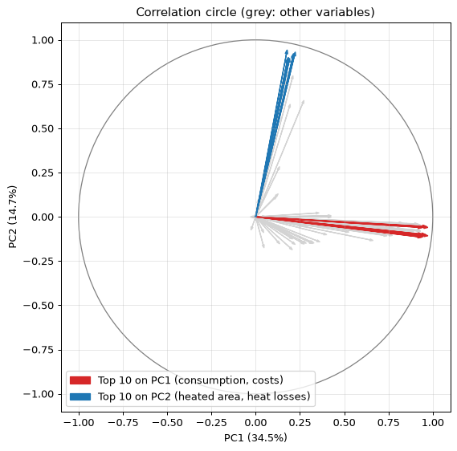
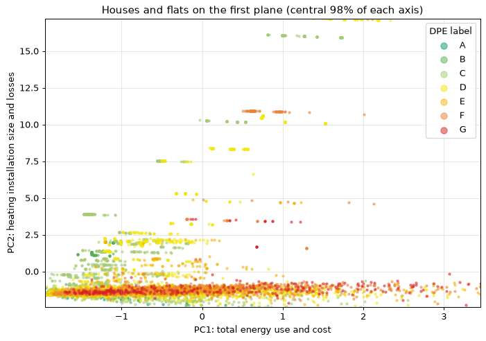

# Energy performance diagnostics (DPE): principal component analysis

[](https://github.com/Nayl-git/dpe-pca/actions/workflows/ci.yml)


Principal component analysis of **8,718 French energy performance diagnostics** (DPE, December 2024),
carried out for the [Open Data University](https://www.opendatauniversity.org/) challenge
*Diagnostics de Performance Énergétique*, proposed by Enedis.

**Context:** BUT Science des Données, 2nd year, 2025 · individual project · Python, pandas, scikit-learn, NumPy, Matplotlib, seaborn

## Key results

| | |
|---|---|
| Dataset analysed | 8,718 diagnostics × 95 numeric variables |
| Variance kept by the first two components | 49% (PC1 34.5%, PC2 14.7%) |
| Components needed for 80% of the variance | 11 of 95 |
| After keeping the 58 most informative variables | first plane 76%, 80% of dwellings well represented (cos² ≥ 0.5) |

- **PC1 measures total energy use and cost** (consumption for all uses, heating, final and primary energy).
- **PC2 measures the size and heat losses of the heating installation** (heated area; losses through the envelope, glazing, air renewal and thermal bridges).
- **The main axes are not the DPE label.** The label is a per-m² measure (Spearman 0.94 with primary energy per m²) and is only moderately linked to PC1 (0.34): a small, badly insulated flat and a large, efficient house can use the same energy in total.

<p align="center">
  
  
</p>

## Method

1. **Preparation:** keep the numeric fields, drop the columns that are at least 50% empty and the constant ones, impute the mean, standardise.
2. **PCA** with scikit-learn, checked against a manual eigen-decomposition of the correlation matrix (NumPy).
3. **Choice of components:** scree plot and cumulative variance.
4. **Interpretation:** loadings, correlation circle, dwellings coloured by DPE label and by type of diagnostic.
5. **Quality of representation (cos²)**, then a second PCA on the variables that build the first plane.

The full analysis, with comments, is in [`dpe_pca.ipynb`](dpe_pca.ipynb).

## Repository

```
dpe_pca.ipynb      analysis notebook, run top to bottom
data/              extract of the ADEME dataset (gzip CSV)
figures/           figures used in this README
tests/             recompute every figure quoted in this README
.github/workflows/ CI: tests + full notebook run on every push
requirements.txt   Python dependencies
```

## Reproducibility

Every number in this README is recomputed by `tests/test_results.py`, independently of the
notebook, and the CI re-runs the whole notebook from top to bottom on every push.

```bash
pip install pytest && pytest -q
```

## Run it

```bash
python -m venv .venv
.venv\Scripts\activate          # Windows  (macOS/Linux: source .venv/bin/activate)
pip install -r requirements.txt
jupyter lab dpe_pca.ipynb
```

## Data

Extract of [*DPE Logements existants (depuis juillet 2021)*](https://data.ademe.fr/datasets/dpe03existant)
published by ADEME under the [Licence Ouverte / Open Licence 2.0](https://www.etalab.gouv.fr/licence-ouverte-open-licence):
diagnostics carried out between 15 and 22 December 2024. Addresses and identifiers (postcodes,
map coordinates, tax and social-housing numbers) were removed from the file.

## Limits and next steps

- Whole-building diagnostics (3% of the rows) dominate PC1; analysing them apart from single dwellings would sharpen the axes.
- Several variables are near-duplicates (final vs primary energy, "dépensier" variants), which inflates the weight of consumption.
- A version based on per-m² variables would focus on efficiency rather than size.
- One week of diagnostics is not a representative sample of the French housing stock.
